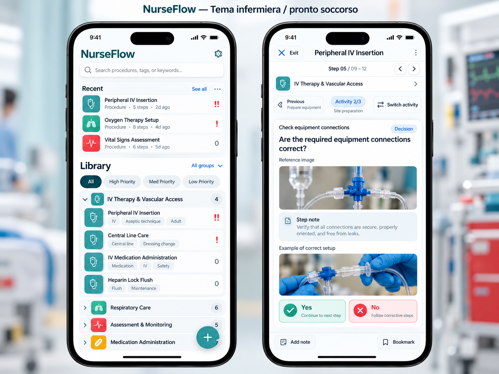

# NurseFlow — Contratto UI e stile visivo v1.0

**Stato:** stile APPROVATO e CONGELATO dall'utente il 29 ottobre 2026. **Ambito:** estetica, design token, comportamento responsive e requisiti di accessibilità. **Non sostituisce** le interazioni delle Pagine 00–11 nella master v3.8.

## 1. Principi non negoziabili

1. **Tema infermiera / pronto soccorso**: atmosfera professionale, pulita, clinica, sobria. La UI deve comunicare orientamento operativo, non simulare un dispositivo medicale o un'interfaccia istituzionale.
2. **Il flusso v3.8 governa il layout**: l'immagine di riferimento è una *moodboard*, non un disegno pixel-perfect. Se mostra un recente verticale, una decisione Yes sempre verde o un controllo estraneo alla master, seguire la master, non il mockup.
3. **Leggibilità e selettività**: le istruzioni e le decisioni sono i contenuti centrali; gruppi, phase, note, immagini, ribbon, badge e priorità sono distinti senza creare rumore.
4. **Densità adattiva**, default compatto; lo slider unico 4–48 pt ricalcola dimensioni di font, box, carte, righe, icone, padding e distanze. Nessun `transform: scale()` applicato indiscriminatamente alla pagina.
5. **No overlap / no bleeding**: niente tagli di testo critico, controlli sovrapposti, scroll orizzontale dell'intera app o contenuti nascosti per estetica. I contenuti possono estendersi verticalmente.
6. **Niente marketing, onboarding superfluo o chrome ridondante**: la PWA è uno strumento personale, offline-first. Nessuna bottom navigation globale.
7. **Colore non è significato clinico**: una risposta Decision `Sì` non è necessariamente positiva né `No` negativa; usare toni neutri per opzioni, salvo un significato esplicitamente dichiarato nell'interfaccia e verificabile. Warnings/Problems e End hanno semantica propria.
8. **Non confondere status applicativo con validazione clinica**: Ready non è certificazione sanitaria. Nessun simbolo o claim che induca a pensarlo.

## 2. Riferimento visuale



L'immagine definisce soltanto carattere visivo: accenti turchesi, superfici chiare, bordi leggeri, icone sanitarie discrete, aree ben separate. Le procedure, l'attrezzatura e i testi clinici nel mockup sono esempi non verificati; non utilizzarli come contenuto procedurale reale. **Non** inserire foto di ospedale come sfondo della UI: fotografie soltanto nelle gallerie multimediali dei passaggi e, se necessarie, nei contenuti esplicitamente caricati dall'autore.

## 3. Design token — light (baseline implementativa)

I codici esadecimali sono valori iniziali concreti del tema approvato; vanno centralizzati nei token e testati per contrasto, non duplicati nei componenti.

| Token | Valore | Utilizzo |
|---|---|---|
| `--nf-bg` | `#F3F8FA` | Sfondo app |
| `--nf-surface` | `#FFFFFF` | Schede, sheet, editor |
| `--nf-surface-soft` | `#EAF3F5` | Contesto, note, meta |
| `--nf-text` | `#142C38` | Testo principale |
| `--nf-text-muted` | `#4A6472` | Metadati e descrizioni |
| `--nf-border` | `#CFDEE4` | Separazione sottile |
| `--nf-primary` | `#076E79` | Azione primaria / focus attivo |
| `--nf-primary-strong` | `#07515C` | Hover/pressed / testo su sfondo chiaro |
| `--nf-primary-tint` | `#E3F3F4` | Selezione leggera |
| `--nf-info` | `#1D668B` | Indicazione informativa |
| `--nf-success` | `#13734F` | Salvataggio completato e successi reali |
| `--nf-warning` | `#996000` | Warnings W01–W08 |
| `--nf-danger` | `#AF2B38` | Errori, Problems, distruzione/Stop contestuale |
| `--nf-focus` | `#075F91` | Contorno focus evidente |

**Priorità 0/1/2** è sempre rappresentata con `nessun simbolo` / `!` / `!!` e relativa etichetta accessibile; non usarla come scorciatoia per un giudizio clinico. **Ribbon** dei procedimenti conservano i colori e le icone personalizzabili approvati, e non vengono tutti forzati a turchese.

### Tema dark

Richiesto da Page 10, da implementare in modo completo: bg `#0E1C24`, surface `#152A34`, text `#F2F7F9`, muted `#B4CCD3`, border `#34505E`, primary `#5ABAC1`, warning `#F0B958`, danger `#F28C95`; derivare le varianti opache e verificare il contrasto. `System` segue l'OS. Una preferenza non funzionante non deve essere mostrata come se funzionasse.

## 4. Tipografia e slider UNICO

`uiScalePt ∈ [4, 48]`, intero, default `13`. Modifica immediata e persistenza locale; `Ripristina 13 pt` sempre raggiungibile nella scheda impostazioni. **Non ci sono** slider separati per spaziatura/testo.

| Ruolo | Regola in punti | Default |
|---|---|---|
| Base UI | `s` | 13 pt |
| Titolo principale | `s + 4` | 17 pt |
| Titolo passaggio | `s + 3` | 16 pt |
| Istruzione / domanda | `s + 3` dove previsto dalla gerarchia approvata | 16 pt |
| Testo regolare | `s` | 13 pt |
| Note | `max(3, s - 1)` | 12 pt |
| Metadati / badge | `max(2, s - 2)` | 11 pt |

Gli offset dei ruoli approvati sono costanti; ai limiti estremi si applicano solo limiti matematici per impedire dimensioni non positive, senza rendere inutilizzabile lo slider. Convertire `pt` in CSS con unità coerenti (1 pt = 4/3 CSS px nel modello nominale), mantenendo supporto a zoom/browser font scaling. Misure geometriche come altezza card, gap, padding, raggio, dimensione icona e contenitore derivano da `s` tramite **token**, senza scalare raster le immagini. A 4pt eliminare quasi tutti i margini ornamentali e lasciare i limiti indispensabili; a 48pt reflow verticale, overflow naturale e CTA sempre raggiungibili.

Esempio orientativo (da utilizzare mediante custom properties **già calcolate in TypeScript**, così le formule rimangono interoperabili):

```ts
const s = settings.uiScalePt; // 4..48
const root = document.documentElement;
root.style.setProperty('--nf-font-base', `${s}pt`);
root.style.setProperty('--nf-font-title', `${s + 4}pt`);
root.style.setProperty('--nf-font-step', `${s + 3}pt`);
root.style.setProperty('--nf-font-note', `${Math.max(3, s - 1)}pt`);
root.style.setProperty('--nf-font-meta', `${Math.max(2, s - 2)}pt`);
root.style.setProperty('--nf-card-pad', `${Math.max(0, 10 * s / 13)}px`);
```

```css
.nf-screen { font-size: var(--nf-font-base); }
.nf-title { font-size: var(--nf-font-title); }
.nf-card { padding: var(--nf-card-pad); }
.nf-metadata { font-size: var(--nf-font-meta); }
```

Questo esempio **esprime solo la logica dei token**, non rappresenta un componente completo. Applicare lo stesso sistema a raggio, gap, line height e dimensioni icona. `min-width:0`, `overflow-wrap:anywhere` su etichette lunghe, `flex-wrap`/grid reflow e `min-height` per controlli interattivi sono obbligatori. Non rimuovere zoom, pinch-zoom o accessibilità OS.

## 5. Componenti e superfici

- **Header:** titolo corto, navigazione contestuale e comandi necessari; niente toolbar decorativa aggiunta.
- **Recent Library:** *tre* scorciatoie ultracompatte in *una riga* come specifica 01; Recent massimo 20% dell'area di browsing e Library almeno 80%. Il mockup visivo può differire: prevale v3.8.
- **Library:** gruppi collassabili, singola appartenenza di procedura a gruppo, nastri verticali colorati con icona, tag, priorità 0/!/!!, ricerca/filtri, shortcut 20 recenti via `···`.
- **Card e container:** superfici chiare, bordo da 1px coerente, radius 8–12px al default, ombra minima o nulla; separazione soprattutto tramite bordi/spazi.
- **Decision:** un pulsante per risposta, nessun outcome scelto automaticamente; testi e note dell'autore conservati. Opzioni non giudicate come 'buone'/'cattive' tramite colore per semplice sì/no.
- **Multitask:** contesto `Attività n/m`, `Cambia attività`, `Termina questa attività` e stato di completamento; non mostrare Join tecnico né confondere AND con Decision.
- **Alert vs problemi di sistema:** allerta sempre visibile se dichiarata; W07 immagine assente mostra placeholder; W08 percorso rotto mostra interruzione distinta da End.
- **Gallerie:** due zone separate prima/dopo nota, modalità compatte e scelte dell'autore, senza alterare rapporti d'aspetto arbitrariamente.
- **Sheet/modal:** azioni chiare, focus trap e ritorno focus, chiusura/annulla; comandi critici confermati.

## 6. Semantica visiva e stati

| Stato | Icona + testo obbligatori | Colore suggerito |
|---|---|---|
| Draft | `Bozza` | Muted |
| Ready | `Ready` (revisione personale) | Primary, non success clinico |
| Problem | `Problema · Pxx` + `Correggi` | Danger |
| Warning | `Avviso · Wxx` + `Esamina` | Warning |
| Saved | `Salvato` solo quando il commit è avvenuto | Success |
| Unavailable image | `Immagine non disponibile` | Muted/warning |
| Broken path | `Percorso non disponibile` + Back/Map/Exit | Danger |
| Disabled | Etichetta di ragione accessibile | Neutral |

Non presentare un risultato Ready o End come “clinicamente sicuro”/“corretto”. Non rendere dispositivi medici o simboli di pronto soccorso elementi interattivi se non hanno un'azione effettiva.

## 7. Responsive e accessibilità

- Schermi principali: 320, 360, 390, 430, 768, 1024 e 1280 CSS px; portrait/landscape.
- Nessun scroll orizzontale del viewport; Graph Canvas può avere pan/zoom **interno** deliberato. Bordi e overlay non devono sanguinare fuori dai contenitori.
- Target minimi: azioni cliniche/decisioni >=56px al default secondo master; controlli secondari idealmente >=44–48 CSS px al default. In scala estrema 4pt nessun controllo interattivo <24 CSS px salvo eccezioni formalmente giustificate; le azioni principali preservano target significativamente maggiori. Questo è un **limite minimo d'accessibilità**, non spazio ornamentale.
- Tastiera: ordine logico, indicatori focus, Escape/cancel coerente, niente operazioni basate solo sul drag. Screen reader: titoli semantici, gruppi, nomi dei pulsanti, annunci di cambi di stato e warning.
- Contrasti: normale >=4.5:1, testo grande >=3:1, controlli/indicazioni non testuali >=3:1 ove applicabile. Dark mode testato separatamente.
- Animazione discreta e disattivabile via `prefers-reduced-motion`.
- Localizzazione IT/EN di tutta la chrome UI; **non** tradurre automaticamente i contenuti scritti nelle procedure.

## 8. Criteri di accettazione dello stile

1. Libreria e Guided Run rispettano esattamente layout/interazioni master, pur adottando il tema pronto soccorso.
2. Cambiando slider 4, 13, 30, 48pt, TUTTI i componenti (non solo il testo) variano dimensioni; nessun elemento incongruentemente fisso salvo soglie touch/sicurezza.
3. A 320px, 48pt non ci sono sovrapposizioni, clipping di istruzioni e CTA irraggiungibili. Scrolling verticale consentito.
4. In dark mode, contrasto verificato e warning/stati distinguibili anche senza colore.
5. A 13pt nessun overflow e Recent in una riga con percentuali master.
6. Page 07 Outline e Graph, Page 08 editor, Page 09 Check, Page 11A/B usano gli stessi token e componenti; niente stile alternativo a metà app.
7. W07 e W08 vengono rappresentati senza falsa conclusione positiva.
8. Nessun caricamento di font, CSS, icone o immagini decorative da CDN.

**Regola di precedenza:** (1) v3.8 decisioni recenti e freeze per comportamento/struttura; (2) questo contratto per estetica; (3) mockup solo come moodboard. Modifiche allo stile congelato richiedono nuova versione del contratto e approvazione esplicita.
