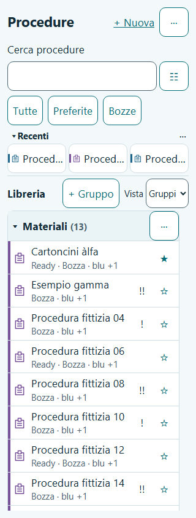

# F03 — First Launch e Library

Data: 29–30 ottobre 2026. Base: `37d0be7` (F02). Ambiente: Windows/PowerShell, Node 26.13.0 e npm 11.20.0 portatili già predisposti in F00. Una fase, nessun push/deploy.

## Implementato

- Page 00: primo avvio persistente, IT/EN rilevata dal browser con fallback English, Start e link alla futura 11B. Start richiede persistenza nel gesto dell'utente, senza attendere il permesso per navigare. DB indisponibile: blocco con Retry. Settings mostra stato effettivo/Retry e ricorda che la persistenza non sostituisce un backup.
- Page 01: procedure/gruppi letti da IndexedDB reale, stato Ready/Draft dai riferimenti reali, ribbon colore/icona allowlist con fallback neutro, tag e alias ricercabili, preferiti e priorità 0/!/!! con nomi accessibili.
- Gruppi: creazione/rinomina con trim e duplicati case-insensitive, ordine, gruppi vuoti e collapse persistenti; eliminazione sempre confermata, riassegnazione atomica a Ungrouped senza cancellare procedure/revisioni/run. Creare da una vista piatta ritorna ai Gruppi e focalizza il nuovo heading.
- Ricerca locale su titolo, gruppo, tag, alias, descrizione e passaggi opzionali; normalizzazione diacritici/case, termini AND, ranking, facet OR interno/AND fra facet. Quick filters Tutte/Preferite/Bozze; gruppi/tag multipli, priorità e stato segmentati, ricerca delle etichette, Reset/Fine. Viste Gruppi/Priorità/Recenti/A–Z.
- Recent: tre scorciatoie in una riga, identità e titolo senza metadati; touch target ≥48px, massimo 20% del browse post-toolbar e Library ≥80%. Alle scale grandi è consentito solo lo scroll orizzontale interno della striscia. Overflow cronologico fino a venti, sheet mobile/popover desktop, titoli completi e metadati. Ricerca/filtri/collapse/vista Recent liberano l'intera area per Library.
- Aperture effettive di Details/Builder/Run aggiornano timestamp e storia con un commit atomico. Preferiti, filtri e autosave non aggiornano i recenti. Le pagine complete successive restano esplicitamente incomplete nelle rispettive fasi.
- Testo, facet, quick filter, vista, collapse e scroll conservati al ritorno. Uno snapshot read-only coerente carica anche i passaggi quando richiesti dai filtri salvati, prima del ripristino dello scroll. Errori di scrittura visibili e Retry; assegnazione preferito idempotente.

## File principali

- `src/domain/library.ts`, `src/domain/model/records.ts`: selezione pura e preferenze versionate.
- `src/storage/commands/library.ts`, `repositories/index.ts`, `migrations/schema.ts`: comandi, snapshot coerente e migrazione v3 non distruttiva.
- `src/features/first-launch/*`, `src/features/library/*`, `src/features/settings/StoragePersistence.tsx`: UI e servizio applicativo, senza accessi diretti a Dexie dai componenti.
- `src/app/*`, `shared/i18n/*`, `shared/styles/tokens.css`: integrazione route, traduzioni offline e token ribbon.
- `src/test/fixtures/library.ts`, `src/domain/library.test.ts`, `src/storage/library.test.ts`, `e2e/fixtures/library*`, `e2e/journeys/library.spec.ts`: fixture fittizie e prove.
- [ADR-004](../adr/004-first-launch-library.md): decisioni tecniche, nessuna modifica ai contratti approvati.

## Test eseguiti

| Comando | Esito finale |
|---|---|
| `npm run typecheck` | PASS, strict app/test/E2E |
| `npm run lint` | PASS, zero errori/warning ESLint |
| `npm run test` | PASS: **140 test in 13 file** |
| `npm run build` | PASS, typecheck incluso; bundle statico generato |
| `npm run test:e2e` | **153 PASS / 4 errori di avvio o chiusura Firefox**, su 157 scenari; tutti i **54 casi F03 PASS** sui tre browser |
| `npm run test:e2e -- --last-failed --project=firefox --workers=1` | **4/4 PASS**, senza modifiche al codice; tutti i 157 scenari risultano verificati dopo questa riesecuzione |
| `git diff --check` | PASS |
| Controllo bundle production | PASS: fixture e harness F03 assenti da `dist` |

Le prove browser usano la build production per primo avvio, Library, DB, routing, preferenze e rollback. Le fixture sono iniettate esclusivamente dal bundle di test compilato in memoria; l'app non precarica procedure e non distribuisce il bundle di test. La matrice UI F02 e i suoi snapshot originali restano parte della regressione.

Copertura F03: selezione, ricerca multi-campo e nei passaggi, facet e quick filter, ordinamento, gruppi/duplicati/focus/collapse/cancellazione, cronologia max20, strip singola e rapporti di altezza, ritorno con filtri/scroll anche nella ricerca nei passaggi, errore quota/Retry, IndexedDB indisponibile/Retry, permessi granted/denied/unsupported/error e richiesta che non termina, 320px × 4/13/30/48pt. Dominio/storage: migrazione v2→v3 con lingua conservata, riapertura, transazioni e rollback senza mutare Ready.

## Verifica visiva e correzioni

Screenshot 320px con fixture non cliniche ispezionato visivamente: palette pronto soccorso, tre Recent compatti, nessuna lista verticale Recent, gruppi e righe con stelle/priorità. Screenshot finale allegato al report Playwright e conservato negli asset del report di fase.

Le prove hanno rilevato e corretto nomi accessibili dei controlli, focus dopo creazione gruppo, reflow a 48pt, persistenza di filtri/scroll nella ricerca nei passaggi e Retry idempotente. Il mock dei permessi sostituisce il manager sul navigator: modificare un singolo wrapper StorageManager non è affidabile in WebKit. Nessuna baseline visiva F02 è stata rigenerata per accettare differenze.

## Compatibilità e limiti

Schema DB **v3**, sette tabelle: nessuna cancellazione dati; F02 mantiene la lingua già scelta. Nessuna nuova dipendenza. Ready, run pinnate, import additivo e relativi comandi non cambiano comportamento.

Dettagli completi di procedure/creazione sono F04; la destinazione 11B è ancora un segnaposto esplicito, senza import o sostituzioni simulate. La prova offline usa la shell già caricata, con ricerca/filtri/preferiti eseguiti senza richieste di rete. Cache PWA, installazione e riavvio completamente offline restano F15. La build segnala un chunk JS >500kB (circa 562kB, 173kB gzip); nessun errore di compilazione.

Durante la suite completa, due contesti persistenti Firefox non si sono avviati entro il timeout, un ulteriore avvio Firefox è fallito e una chiusura ha prodotto un errore del protocollo browser. Questi quattro scenari di regressione F01/F02 sono passati nella riesecuzione isolata con un worker. La suite completa non viene descritta come un'unica esecuzione senza errori; resta registrata la fragilità del lifecycle Firefox in questo ambiente. Il report HTML Playwright corrente contiene la riesecuzione dei quattro casi.

**NON ESEGUITO:** Safari iOS PWA e Chrome Android su dispositivi fisici, screen reader reale, test prestazionali su telefono rappresentativo e deploy GitHub Pages. I browser Playwright non sostituiscono questi gate. Non si dichiara il prodotto pronto per uso reale.

## Handoff

Gate funzionale F03 raggiunto: Pages 00/01 reali, persistenza e rollback verificati, tutti i casi di fase passati sui tre browser e regressioni verificate dopo la riesecuzione descritta. Prossima fase assegnabile: **F04 — Details e New Procedure**, riusando metadati reali, gruppi e confine di registrazione delle aperture. Nessuna fase successiva implementata anticipatamente.
