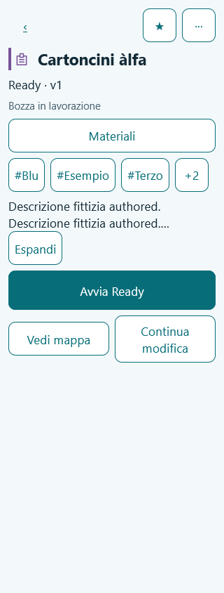
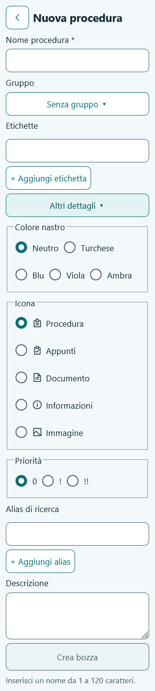

# F04 — Procedure Details e New Procedure

Data: 30 ottobre 2026. Base: `e7514dc` (F03). Ambiente: Windows/PowerShell, Node 26.13.0 e npm 11.20.0 portatili già predisposti in F00. Una fase, nessun push/deploy.

## Implementato

- Page 02 compatta: identità/ribbon condivisa con Library, titolo authored, stato Ready/Draft e versione, gruppo, tag con +N/Meno e descrizione espandibile. Nessuna lingua della procedura, alias o data superflua nella vista predefinita.
- Stati Draft-only, Ready-only e Ready+Draft con azioni contestuali e revisioni esplicite. Ready-only aperta in editor resta Ready-only; nessuna Draft salvata per la sola navigazione. Ready e Draft indipendenti, Mappa su Ready quando presente, Anteprima Draft senza sessione persistita e con indicazione permanente.
- Start/Start Ready legge la Ready attesa, controlla caricabilità strutturale e salva una sessione iniziale pinned. Resume riusa la stessa sessione/revisione, anche se conservata su un End authored. Errore Start con recupero/Retry specifico e accesso al grafo. Nessun avanzamento, scelta automatica o esito clinico introdotto anticipatamente.
- Modifica dettagli con autosave transazionale: titolo, gruppo singolo, tag, alias, descrizione, priorità 0/!/!!, colori e icone allowlist. Valori authored conservati; traduzione limitata alla chrome UI. Fine/chiusura attendono il commit; errori visibili e Retry con input conservati.
- Preferito idempotente, navigazione dai tag/gruppo ai facet di Library e ritorno con contesto. Correzione del matching visuale dei tag con casing diverso ma identica forma normalizzata.
- More nell'ordine congelato: Modifica dettagli, Duplica, Esporta, Archivia, separatore, Elimina. Duplicato con nuova Draft/identità editoriali; archive/restore conservativo e lista Archiviate. Delete confermato, atomico e impedito con sessioni salvate. Export/Export first aprono la futura 11A con la procedura selezionata.
- Page 06: nome richiesto e massimo 120 caratteri, gruppo/picker con creazione inline, tag e dettagli opzionali collassati. Creazione atomica di procedura + Draft + unico Start verso unassigned, senza Ready o istruzioni precompilate. Persistenza prima della navigazione a Builder, ricarica verificata.
- Back del modulo New conferma lo scarto; il browser Back non smonta il form prima della decisione. Back nello sheet metadati attende i salvataggi prima di chiuderlo. Il guard viene rimosso sincronicamente all'unmount, prima di una navigazione successiva. Portal e submit isolato del dialog gruppo impediscono che Enter crei prematuramente la procedura.

## File principali

- `src/domain/procedures.ts`: metadati, allowlist, stati, copia del grafo e controllo iniziale Ready.
- `src/storage/commands/procedures.ts`, `procedure-removal.ts`, `repositories/index.ts`, `db.ts`: transazioni, snapshot, sessione iniziale e rimozione esplicita controllata.
- `src/features/procedures/*`: Details, New, autosave, campi, tag/alias, picker gruppo, adattatori di ingresso e guard di navigazione.
- `src/shared/navigation/pop-guard.ts`, `src/app/providers.tsx`: coordinamento Back con HashRouter, senza sostituzione dello stack.
- `src/shared/i18n/procedure-resources.ts`, route/app e integrazioni Library: IT/EN, archiviate e identità coerente.
- Test dominio/storage/componenti, `e2e/journeys/procedures.spec.ts` e harness IndexedDB reale.
- [ADR-005](../adr/005-procedure-details-and-creation.md): motivazioni, confini delle fasi e salvaguardie.

## Test eseguiti

| Comando | Esito |
|---|---|
| `npm run typecheck` | PASS, app/test/E2E strict |
| `npm run lint` | PASS, zero errori/warning ESLint |
| `npm run test` | PASS: **162 test in 17 file**, comando standard sul sorgente finale |
| `npm run build` | PASS, typecheck incluso; build statica generata |
| `npm run test:e2e -- --workers=1` | **202 PASS, 3 timeout** su 205; Chromium/Firefox/WebKit, 36,2 minuti |
| `npm run test:e2e -- --last-failed --workers=1 --timeout=90000` | **3/3 PASS**, 2,9 minuti |
| E2E WebKit isolato dopo fix cleanup | **1/1 PASS**, caso 4pt in 7,8s (limite ordinario 45s) |
| E2E mirati finali, comando sotto | **27/27 PASS**, Start/Resume, Back e 320px sui tre browser; 2,1 minuti |
| `git diff --check` | PASS |
| Controllo bundle | PASS: fixture e harness di test assenti da `dist` |

Dominio/storage: metadati preservano Ready/Draft/run/recenza; commit quota in rollback; Start/Resume pinned, incluso End già salvato; Draft duplicata indipendente; archiviazione e rimozione esplicita con rollback; creazione e ricarica; titoli uguali con ID distinti. Componenti: tre stati di Details, destinazioni corrette, nessuna creazione su Edit Ready-only, recupero per dati mancanti/corrotti e messaggio specifico Start mantenuto al Retry.

E2E di fase: tre stati reali, Mappa/Edit/Preview e revisione scelta, Start/Resume, autosave e lingua, group/tag facet, errori quota/Retry, Back nativo, gruppo creato dal form senza procedura prematura, nuova Draft dopo reload, More/duplicate/archive/restore/delete, rifiuto di riferimento a Ready altrui, operazioni offline nella shell caricata, 320px × 4/13/30/48pt con controlli di overflow e sovrapposizione. La regressione comprende le fasi precedenti e le baseline visive F02, senza rigenerarle.

Riesecuzione mirata dopo le correzioni finali a Resume, errore Start e header:

```sh
npm run test:e2e -- e2e/journeys/procedures.spec.ts --grep 'Ready\+Draft:|Resume riapre|Start con Ready|Details e New|autosave quota|New Back e browser' --workers=1 --timeout=90000
```

La prima suite completa ha superato il limite di 45s in tre casi: Firefox durante il setup della pagina della migrazione F01; WebKit durante il flusso lungo More; WebKit a 30pt nel passaggio dallo sheet metadati a New. I tre casi sono passati nella prima riesecuzione con 90s; il timeout ordinario del repository resta 45s. Non si descrive la prima suite come un'esecuzione senza errori.

Un successivo gruppo mirato intermedio ha riprodotto il blocco WebKit a 4/13pt anche attendendo la scomparsa dello sheet; è stato interrotto per correggere la causa. Il guard Back rimaneva registrato fino al cleanup passivo di React e poteva consumare la navigazione successiva. Il cleanup ora avviene nel layout effect, sincrono all'unmount. Il caso 4pt isolato è passato in 7,8s dopo la correzione. Le 27 verifiche finali includono i quattro valori di scala e i due flussi Back su ogni browser. Report HTML locali conservati: `playwright-report/index.html`, `playwright-report/f04-rerun/index.html`, `playwright-report/f04-guard/index.html` e `playwright-report/f04-final-verified/index.html`.

La prima esecuzione unit con i due casi aggiunti, contemporanea ai browser, ha avuto due timeout nei test preesistenti components/appearance (160 PASS, 2 FAIL). La successiva esecuzione completa in sequenza con un worker ha passato tutti i 162 test, senza modificare i loro limiti. Dopo il fix del cleanup, anche `npm run test` standard ha passato tutti i 162 test (21,5s), con i browser già terminati. Typecheck, lint e build sono stati ripetuti sul codice finale.

Totale E2E distinto verificato dopo correzioni e riesecuzioni: **211 casi**, di cui **54 F04** (18 per browser). La regressione completa iniziale e le successive esecuzioni mirate sono documentate separatamente sopra.

## Verifica visiva

Screenshot finali a 320px e 13pt di Details e New ispezionati visivamente e conservati negli asset di fase. La verifica visiva ha rilevato la disposizione verticale involontaria di Favorite/More: l'header ora usa tre controlli diretti, con target di almeno 48px e Back a sinistra. I test controllano allineamento su una riga a 4/13pt, titolo/identità/priorità senza sovrapposizione e reflow di form, sheet e azioni a 30/48pt.





## Limiti e compatibilità

DB resta **v3**, sette tabelle, nessuna migrazione e nessuna dipendenza nuova. Ready non viene aggiornata in place. Solo Delete esplicito autorizza nella propria transazione la rimozione delle revisioni del proprietario e soltanto senza sessioni salvate; le altre cancellazioni Ready restano vietate. La GC dei Blob non è introdotta.

Builder completo F05/F06, motore Run F09, schermata guidata F10 e Mappa completa F11 restano incompleti: i destinatari mostrano lo stato di implementazione e la revisione effettiva, senza simulare i relativi strumenti. Preparazione di file e download portable restano F13; F04 collega il loro ingresso, senza esportazioni finte o formati aggiuntivi. PWA/cache/riavvio offline restano F15; la prova offline di fase parte dalla shell già caricata. La build segnala il chunk JS principale >500kB (circa 592kB, 181kB gzip), senza errori di compilazione.

**NON ESEGUITO:** iOS Safari PWA/Android Chrome su dispositivi fisici, screen reader reale, deploy GitHub Pages e gate di rilascio F16. I test browser automatizzati non sostituiscono queste prove.

## Handoff

Gate funzionale F04 raggiunto dopo le correzioni e le riesecuzioni documentate; le temporizzazioni/lifecycle dei browser in questo ambiente restano un limite della verifica completa iniziale. Prossima fase assegnabile: **F05 — Builder Outline**, creando la working Draft di una Ready-only soltanto al primo cambiamento reale del grafo. Nessun contratto approvato modificato.
