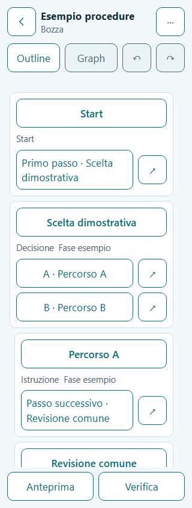
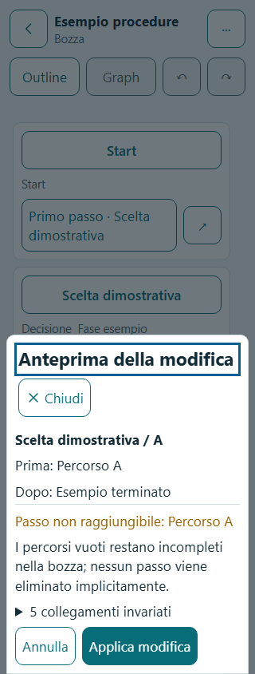
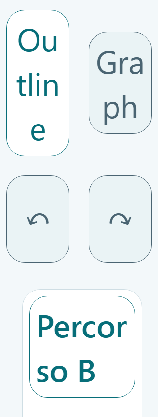

# F05 — Builder mobile Outline, Page 07

Data: 30 ottobre 2026. Base: `fcb601d` (F04). Ambiente: Windows/PowerShell, Node 26.13.0 e npm 11.20.0 portatili predisposti in F00. Una fase, nessun push/deploy.

## Implementato

- Page 07 usa il DAG della revisione reale, dietro repository e comandi. Header Back/identità/Draft/More, toolbar Outline/Graph e Undo/Redo, pannello Outline, azioni Preview/Check. Graph/auto-layout mostrano il motivo della disabilitazione F06.
- Nodi canonici resi una volta, riferimenti che portano al nodo condiviso, selezione distinta per nodo/attività/edge con stato accessibile. Indentazione limitata, titoli authored, fasi e indicatori di media/orfani; nessun Join o completamento fittizio.
- `+` esclusivamente negli outlet vuoti; menu Create next step / End procedure here / Go to existing step, localizzato IT/EN. Picker “Prendi una decisione” e “Attività multitasking”. Nuovi nodi con contenuti vuoti: creazione e collegamento automatico in un commit prima di aprire la vera route Page 08. L'adattatore verifica appartenenza, revisione e ID del nodo; l'editor completo resta F07.
- Quattro End: Completed/Stopped/Escalation/Neutral. AND con Finish this activity esplicito, After all activities e Stop entire procedure solo verso Stopped/Escalation con scelta e consenso sulle attività incomplete. Un outlet vuoto non completa un'attività. Nessun normale End permette di saltare il completamento richiesto.
- Decision/Multitask con due slot iniziali vuoti, massimo 32, rinomina/riordino/aggiunta/rimozione e ricerca locale delle liste. Draft con 0/1 voci consentita. Completezza Ready e diagnostica P/W sono F08, senza validazione permissiva inventata in F05.
- Azioni contestuali su edge: View, Insert before, Change connection, Disconnect. Preview Prima/Dopo dell'esatto collegamento, invariati espandibili, nuovi orfani, contenuti aggiunti/rimossi e impatto delle fasi rimosse. Cancel non muta il DAG; nessun discendente viene cancellato implicitamente.
- Copy/Paste con nuovi ID editoriali, contenuti/note/media/gallerie e fasi conservati; Blob locali immutabili condivisi, senza GC. Copia singola senza link esterni; attività/gruppi con sottografo interno, anche annidato e con Stop esplicito. Trasferimento Copy tra procedure locali.
- Cut pending esclusivamente in memoria: originale intatto fino alla conferma Paste. Move sorgente+destinazione atomico e unico Undo; Cancel/reload senza mutazioni. Ingressi condivisi protetti con elenco dei percorsi; Cut verso un'altra Draft rifiutato con invito a usare Copia. Nessun permesso clipboard OS o upload.
- Undo/Redo persistenti: ultime 30 transazioni con stessi ID, link, fasi, layout e riferimenti ai media; nuovo edit dopo Undo elimina Redo. Cancellazione di nodo trasforma gli ingressi in W08 con titolo/ID storici; Undo ripristina il nodo e tutti gli ingressi.
- Ready-only rimane tale all'ingresso. Primo edit crea direttamente Draft modificata + puntatore + history in una sola transazione, senza scrivere Ready o sessioni pinned. Token/grafo attesi proteggono da preview obsolete. Quota e altri errori fanno rollback, conservano proposta/input e offrono Retry o ricarica confermata.
- Scroll e selezione persistono senza recenza o voci Undo. Le scritture della vista non bloccano i controlli o la navigazione e non cancellano gli errori di dominio. Header Back, Preview e Check attendono la coda; la ricarica dopo errore ripristina anche la coda utilizzabile.
- Scala 4–48pt tramite token globali. Pannello scorrevole alla scala ordinaria; flusso del documento con toolbar sticky quando la chrome non lascia spazio sufficiente. Scroll-padding e focus evitano target coperti; ripristino dello scroll verificato in entrambe le modalità. Cut pending non espande la toolbar sticky.

## Architettura e dati

`src/domain/builder/*` contiene modifiche pure, identificatori degli edge, verifica DAG/scope, clipboard e diff di impatto. `src/storage/commands/builder.ts` salva le transazioni; `repositories/builder.ts` legge snapshot coerenti. `src/features/builder/*` contiene service, controller e sheet contestuali. Nessun componente chiama `db.*`, nessuna dipendenza aggiunta.

DB **v4**, otto tabelle: aggiunge solo `builderStates`. La migrazione v3→v4 preserva Ready, Draft, run e preferenze; le precedenti versioni sono invariate. `terminateProcedure: true` opzionale sull'edge rappresenta l'uscita eccezionale autorizzata, mai dedotta dal solo End. La copia/remapping conserva il flag. Nessuna trasformazione o cancellazione di dati esistenti all'upgrade. [ADR-006](../adr/006-builder-outline-and-history.md).

## Verifiche

| Comando / suite | Esito |
|---|---|
| `npm run typecheck` | PASS, app/test/E2E strict |
| `npm run lint` | PASS, zero warning |
| `npm run test` | **202/202 PASS in 21 file**, comando standard sul sorgente finale; 36,2s |
| `npm run build` | PASS, typecheck incluso e build statica generata |
| `git diff --cached --check` | PASS |
| Controllo bundle | PASS: fixture e harness assenti dalla build di produzione |
| Regressione Builder/Details/smoke/storage, tre browser | **163/165 PASS**, 2 difetti nel caso Copy/Cut tra procedure; 15,1 minuti |
| Builder dopo correzioni, tre browser | **60/60 PASS**, 10,5 minuti |
| Verifica successiva ingresso/toolbar 320px e migrazione v1→v4 | **15/15 PASS**, 2,9 minuti |
| Ready-only: rinomina invariata, anche con fase opzionale assente, poi primo edit | **3/3 PASS**, tre browser; 2,3 minuti |

La prima matrice ha individuato due problemi reali: in Firefox un salvataggio della view cancellava il messaggio di rifiuto Cut; in WebKit la view attivava il guard Back e poteva impedire il cambio di procedura. Le scritture della vista ora usano la coda senza bloccare navigazione/controlli o cancellare gli errori; il test verifica anche l'effettivo ingresso nella procedura destinataria. La successiva suite completa Builder passa sui tre browser.

Le prime verifiche di scala hanno rilevato il contenitore sticky troppo corto e l'header parzialmente fuori schermo dopo Settings. Corretti altezza intrinseca del pannello e ripristino del documento nella modalità con scroll interno; aggiunte asserzioni geometriche su header e Undo/Redo, anche durante Cut/Paste. I 15 casi successivi passano sul codice corretto.

La prima esecuzione unitaria standard aveva due timeout di 5s nei test di stress (2.400 rewiring e 35 commit con storia/media). Il limite locale di quei due test è 15s; sequenze e asserzioni sono invariate. La riesecuzione standard è passata. Gli E2E sono eseguiti serialmente con limite CLI di 90s: il default del progetto resta 45s; un caso Firefox in questo ambiente ha richiesto 54,8s. Nessun PASS dichiarato per l'intera matrice con il limite ordinario.

Comandi E2E riproducibili:

```sh
npm run test:e2e -- e2e/journeys/builder.spec.ts e2e/journeys/procedures.spec.ts e2e/journeys/smoke.spec.ts e2e/journeys/storage.spec.ts --workers=1 --timeout=90000
npm run test:e2e -- e2e/journeys/builder.spec.ts --workers=1 --timeout=90000
npm run test:e2e -- e2e/journeys/builder.spec.ts e2e/journeys/storage.spec.ts --grep '320px|migrazione reale v1' --workers=1 --timeout=90000
npm run test:e2e -- e2e/journeys/builder.spec.ts --grep 'Ready-only resta' --workers=1 --timeout=90000
```

Report HTML locali in `playwright-report/f05-matrix`, `f05-final`, `f05-ui-final`, `f05-ready-final` (esclusi da Git).

Le property verificano 200 sequenze riproducibili di rewiring (2.400 tentativi) con oracolo Kahn indipendente, coppie cross-arm su gruppi da 2 a 32 attività e 100 Copy/Paste consecutivi. Verifiche mirate su invarianti/ID (anche delimitatori avversi negli ID), annidamento, quattro End, media/fasi, W08, storia persistente, stale preview, quota/rollback e migrazione.

La migrazione v3→v4 con tutti i record preservati è verificata nei test Dexie su fake-indexeddb; la regressione E2E verifica anche l'upgrade v1→v4 su IndexedDB dei tre browser reali e l'immutabilità della Ready.

Gli E2E usano IndexedDB e HashRouter reali, con fixture editoriali fittizie compilate esclusivamente nell'harness di test. Coprono l'outcome 19 di 32, attività 27 di 32, Copy tra procedure, rifiuto Cut tra Draft, shared/cancellazione/Undo, Stop con consenso, Retry e ricarica dopo quota, prima Draft da Ready, ritorno Details, editing nella shell già caricata offline e 320px × 4/13/30/48pt. Nessuna fixture viene caricata dall'app di produzione.

## Verifica visiva

Screenshot finali Chromium ispezionati e conservati: Outline e impact preview a 320px/13pt, toolbar e target nel flusso a 48pt. La scala grande mantiene i token tipografici e rende scorrevole il contenuto; nessuna riduzione artificiale del testo.







## Limiti e handoff

F05 implementa Outline. Canvas Graph e connection picker visuale restano **F06**; editor completo dei contenuti/media **F07**; Check & Mark Ready **F08**; runtime/Guided **F09/F10**; Map **F11**; file/export **F13/F14**. Preview/Check/Export aprono i destinatari previsti con revisione/procedura effettive senza simulare il completamento di quelle fasi.

La build segnala il chunk JS principale oltre 500kB: **643,24kB**, **194,26kB gzip**, senza errori di compilazione. Nessuna dipendenza aggiunta o warning nascosto modificando le soglie.

Offline verificato nella shell già caricata; riavvio offline/cache/PWA restano F15. **NON ESEGUITO:** Safari PWA iOS/Chrome Android su dispositivi fisici, screen reader reale, deploy GitHub Pages e gate di rilascio F16. I test browser automatizzati non sostituiscono queste prove.

Prossima fase assegnabile: **F06 — Builder Graph + connection picker**, sugli stessi comandi/DAG. Nessun contratto approvato modificato.
