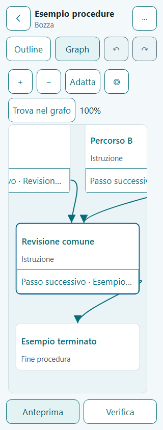
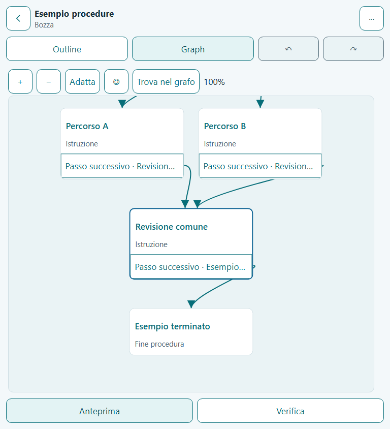

# F06 — Builder Graph e connection picker, Page 07

Data: 30 ottobre 2026. Base: `0c84ee4` (F05). Ambiente: Windows/PowerShell, Node 26.13.0 e npm 11.20.0 portatili. Una fase, un commit locale.

## Implementato

- Outline e Graph leggono il medesimo `revision.graph`. Il renderer SVG/React è caricato con `lazy()`; la proiezione contiene ID, geometria e porte visibili, senza un secondo grafo editabile o contenuti di mockup.
- Pan sullo sfondo, pinch, pulsanti zoom, Fit, centro della selezione e ricerca locale. Selezione distinta di nodo, outcome/porta e freccia con gli stessi sheet e comandi F05. Tastiera: focus dei controlli, Invio/Spazio sugli edge, frecce per pan, Home/Fit, +/− e Escape nel picker.
- Collegare usa tap-to-target o ricerca per focalizzare e successivo tap. La ricerca non assegna una destinazione. Il contesto identifica l'esatto edge; la preview mostra Prima/Dopo, invariati e nuovi orfani prima di Apply. L'alternativa Outline mantiene gli stessi controlli di ciclo/scope. Non occorre trascinare linee.
- Convergenze in una sola card canonica, frecce dirette e ingressi distinti. `+` soltanto sulle porte `unassigned`; W08 ha testo e bordo distinto, senza freccia sana verso il nodo eliminato. Undo ripristina identità e ingressi.
- AND con una, due o fino a tre attività in focus secondo viewport/scala, indice reale, numero visibile e Browse ricercabile fino a 32. OR numerosi con focus/Browse equivalente. Nessuna riduzione automatica dei caratteri per fare entrare 32 voci. I completamenti raggiungono direttamente la continuazione, anche con gruppi annidati; nessun gate, join o merge visibile o aggiunto al DAG.
- Copy/Cut/Paste, history, Ready-only, stale preview, quota/rollback e Retry usano i comandi transazionali F05. Cut resta pending fino al Paste confermato. Auto layout modifica solo `graph.layout.positions` ed è undoable; preserva i contenuti, Ready e run pinnate.
- Ultima modalità sul dispositivo, camera/focus per procedura e scroll Outline persistono in IndexedDB. Pan/zoom/focus non creano Draft, recenza o voci Undo. La lista temporanea dei target conserva lo scroll abituale dell'Outline, incluso lo scroll del documento a 48pt.
- Token globali 4–48pt. Il canvas contiene il pan interno; Fit può offrire una panoramica, mentre il primo tap torna alla dimensione di modifica. Il layout misura anche controlli Graph e contesto del picker: a 320×568 usa il flusso verticale con toolbar sticky e footer separato dal canvas.

DB **v4**, otto store: nuovi campi con default compatibili, nessuna migrazione o riscrittura di snapshot esistenti. Nessuna dipendenza aggiunta. Contratti in `docs/nurseflow` invariati. [ADR-007](../adr/007-builder-graph-projection.md).

## Verifiche effettive

| Comando / suite | Esito |
|---|---|
| `npm run typecheck` | PASS, app/test/E2E strict |
| `npm run lint` | PASS, zero warning |
| `npm run test` | **214/214 PASS in 22 file**, comando standard; 17,96s |
| `npm run build` | PASS, build statica finale e typecheck; verificata anche prima delle matrici E2E |
| Regressione Outline F05 completa | **60/60 PASS**, 20 scenari × Chromium/Firefox/WebKit nella prima matrice |
| Graph, 18 scenari principali | **54/54 PASS** sui tre browser, ultima matrice completa |
| Outline 320px × 4/13/30/48pt | **12/12 PASS** sui tre browser, stessa matrice |
| Scroll del documento a 48pt, Graph e picker annullato | **3/3 PASS** nella riesecuzione mirata finale |

I **19 scenari Graph** sono verificati su tutti e tre i browser: 57 casi complessivi fra matrice e riesecuzione mirata. La matrice da 69 casi aveva 66 PASS e tre fallimenti nel test aggiuntivo a 48pt. Il trace ha mostrato che il browser scorreva per raggiungere Graph prima del clic; inoltre Firefox restituiva uno scroll frazionario. Il test ora registra la posizione all'effettivo clic, senza alterare l'azione, e confronta il ritorno con tolleranza di un CSS pixel. La riesecuzione di quel test passa nei tre browser; non si dichiara un singolo run da 69/69 PASS.

Durante lo sviluppo i nuovi test hanno anche rilevato due selettori ambigui e uno scroll del picker che sostituiva quello dell'Outline: selettori corretti, stato della vista corretto e regressione passata sui tre browser.

Comandi E2E riproducibili, eseguiti serialmente con timeout CLI 90s; il default del progetto resta 45s:

```sh
npm run test:e2e -- e2e/journeys/graph.spec.ts e2e/journeys/builder.spec.ts --workers=1 --timeout=90000
npm run test:e2e -- e2e/journeys/graph.spec.ts e2e/journeys/builder.spec.ts --grep 'graph.spec.ts|320px Builder' --workers=1 --timeout=90000 --reporter=list,html,json
npm run test:e2e -- e2e/journeys/graph.spec.ts --grep 'Outline a 48pt' --workers=1 --timeout=90000 --reporter=list,html,json
```

Report locali esclusi da Git: `playwright-report/f06-matrix`, `f06-final`, `f06-verified` e `f06-scroll`. Gli ultimi due contengono anche `results.json`.

Dominio/storage: identità canoniche, frecce distinte, 32 voci, AND annidati, ID arbitrari, geometria finita senza sovrapposizioni a 320/390/768px × 4/13/30/48pt, camera, ciclo/cross-arm, layout reversibile e quota sulle preferenze. Le invarianti e le transazioni F05 restano nella suite completa.

Gli E2E usano IndexedDB e HashRouter reali con fixture editoriali fittizie iniettate solo dal test. Coprono shared destination, modifica del solo edge A lasciando B intatto, ricerca senza assegnazione, cycle/cross-arm rejection, W08, Undo/Redo tra viste, quota/Retry/reload, camera/mode, attività 27 ed esito 19, Cut/Paste offline, Ready-only e auto layout. Nessuna fixture è presente nel bundle production; nessun componente accede a `db.*`.

## Evidenze visive

Screenshot finali Chromium 13pt ispezionati: [320px](assets/F06-graph-320px.png), [390px](assets/F06-graph-390px.png), [768px](assets/F06-graph-768px.png), [impact preview 320px](assets/F06-graph-impact-320px.png). La scena può uscire dal viewport interno durante il pan; i controlli e i contenitori dell'app restano nei propri limiti.





## Limiti e prossima fase

Editor contenuti/media **F07**, Check/Ready completo **F08**, runtime/Guided **F09/F10** e Map read-only **F11** restano nelle rispettive fasi. Graph mantiene le destinazioni e le invarianti editoriali; non simula esecuzioni o risultati clinici.

Offline verificato nella shell e nel modulo Graph già caricati. Cache PWA, riavvio completamente offline e aggiornamenti differiti sono **F15**. Il build mantiene l'avviso sul chunk principale oltre 500kB: 654,62kB, 198,52kB gzip. Graph ha JS separato da 12,72kB (4,63kB gzip) e CSS separato; nessuna dipendenza aggiunta o soglia di warning modificata.

**NON ESEGUITO:** iOS Safari/Android Chrome su dispositivi fisici, gesti multitouch fisici, screen reader reale, browser zoom 200%/400%, deploy GitHub Pages e gate di rilascio F16. I browser automatizzati desktop non sostituiscono queste prove.

Prossima fase: **F07 — Page 08, contenuti e media**, riusando il picker F06 e lo stesso DAG.
